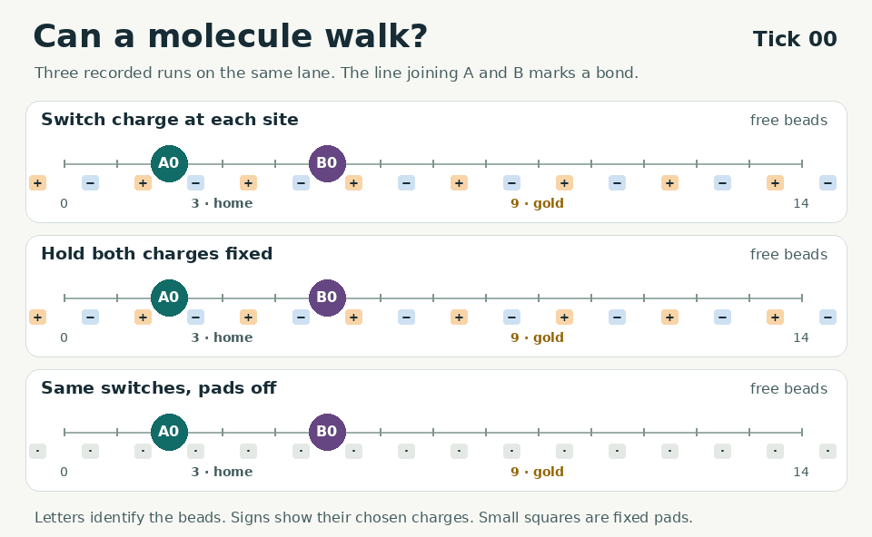
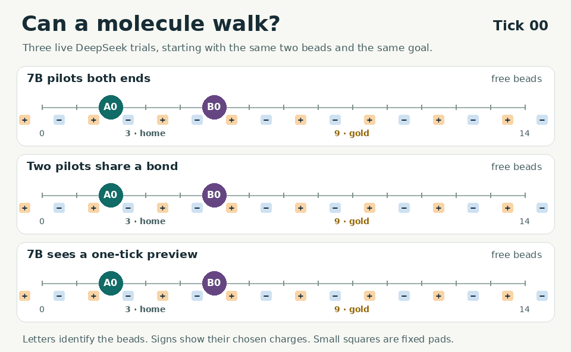

# The charge walk

Two imaginary elements became one mobile molecule on November 26, 2026. Each bead could choose a positive, neutral or negative charge. The entire route below was produced from those choices and the field under the beads. The experiment is a local toy world with fixed charges in the floor and a permanent bond on contact. Its positions and force scores are in game units. [Registered law and predictions](PLAN.md)



## How one step worked

A and B began at sites 2 and 5. On tick one they took opposite charges, moved to 3 and 4, and bonded. The matched single-tick runs with two positive charges moved apart to **1 and 6**. With one neutral bead they stayed at **2 and 5**.

Now consider the bonded molecule at sites 3 and 4. On the powered track a negative A and positive B each contributed **+2** eastward force, moving the whole bond one site east. At the new sites the layout of the pads was reversed. Holding those charges would push the bond back west. Reversing both charges made the next step east. The pilot never entered a destination or a movement command.

| Recorded controller or change | What happened to the bonded pair |
|---|---|
| Feedback controller, intact track | A reached gold at site 9 on tick 7 and returned to site 3 on tick 13. The pair made six steps out and six back. |
| Same recorded charge choices, unpowered track | A and B bonded on tick 1 and stayed at 3 and 4 through tick 13. |
| First walking charges held fixed | The bond rocked between 3–4 and 4–5. The repeated movements produced no net travel by tick 13. |
| One missing pad | The controller crossed the gap and completed the same round trip in 13 ticks. |
| Three consecutive missing pads | The pair reached 7–8 on tick 5. Neither end sensed a gradient there, and the bond stayed put through tick 16. All nine possible charge pairs give zero net force there. |

The feedback controller is a short programmed rule. The no-power comparison replayed each of its actual choices. The missing-pad trials let the same controller read the changed track. [All eight control records](controls.json)

## The pilots

The local DeepSeek-R1-Distill-Qwen checkpoints chose charges through a constrained public menu. Both model trials on the original interface saw the current local gradients, the previous forces and the destination. The 7B solo pilot chose the two charges together. At the shared controls, 1.5B chose A, then 7B saw that choice and chose B before the world advanced.

- **7B steering both ends.** It bonded on tick 1 and reversed the charges for two consecutive eastward steps, reaching 5–6 on tick 3. It then selected two neutral ends and paused. On tick 5 it reused its earlier signs at their new positions, which pushed it west. It eventually touched the left wall and ended at 2–3 after sixteen ticks. It demonstrated directional walking for two steps and missed gold. [Every choice and position](solo.json)
- **Two pilots sharing the bond.** Together they chose positive A and negative B, bringing the beads into contact on tick 1. They kept those signs on tick 2 and stepped west. At 2–3 on tick 3, A went neutral and B stayed negative. B alone supplied the eastward force that moved both of them back to 3–4. They repeatedly crossed between those same two positions. After nine physical ticks, 1.5B chose to leave before tick 10 could advance. [Paired decisions](pair.json)

- **7B with a one-tick preview.** In the follow-up, 7B could inspect the next two positions for every charge pair before committing. It reached 7–8 on tick 7, two sites farther east than its first solo run. It then paused and reversed and finished at 6–7. The prediction of a farther excursion held in this pair of runs. None of the three model trials reached gold. The round trip belongs to the scripted feedback controller. [Preview pilot record](preview.json)



## Reproduce or steer the molecule

From the experiment directory, the following commands need Python 3.12. The verifier rebuilds each prompt, charge choice, force and position and checks the stopping condition. Live inference is needed only for new model choices. The public call records are operator captures; replay reproduces the mechanics from them.

```sh
python3 pilot.py
python3 pilot.py --track wide-gap
python3 run.py controls /tmp/fresh-charge-controls.json
for log in controls solo pair preview; do python3 run.py verify "$log.json"; done
```

To rerun local inference use llama.cpp b12780, the two pinned weights and the commands below in separate terminals. Python ran as 3.12.14. The hashes for 1.5B and 7B are recorded with their revisions in [the checkpoint manifest](../005-consciousness/PROTOCOL.md#replay-and-verification). Each request records its exact seed and sampler settings. Run `python3 run.py solo /tmp/fresh-solo.json`, `pair` or `preview` with a new path. Each command preserves existing files.

```sh
llama-server -m "$DS_SMALL_GGUF" --alias deepseek-local --host 127.0.0.1 --port 18401 -t 4 -c 4096 -np 1 --reasoning-budget 0 --reasoning-format deepseek --no-webui
llama-server -m "$DS_LARGE_GGUF" --alias deepseek-seven --host 127.0.0.1 --port 18402 -t 4 -c 4096 -np 1 --reasoning-budget 0 --reasoning-format deepseek --no-webui
```

The optional renderer reads the saved positions directly. With Pillow and the DejaVu Sans fonts installed, use `python3 render.py walk.gif` for the control comparison or `python3 render.py pilots.gif --pilots` for the three model trials. [World rules](field.py) · [Experiment runner](run.py) · [Scenario course](../SCENARIO-COURSE.md)
